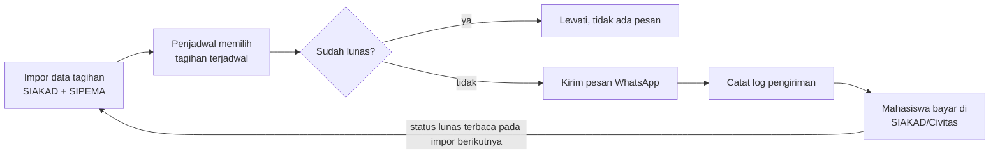

# BRD Sistem Penagihan Uang Kuliah via WhatsApp

Oct 30, 2026 · Titis Marselina

> Salinan Markdown dari dokumen BRD v0.1 (draf awal untuk direview). Isi tidak diubah. Desain
> teknis yang mengacu pada dokumen ini ada di
> [`docs/superpowers/specs/2026-10-31-kampusping-design.md`](superpowers/specs/2026-10-31-kampusping-design.md).
> Satu keputusan teknis menyimpang dari rekomendasi BRD bagian 10 (kanal WhatsApp), lihat
> [ADR 0002](adr/0002-baileys-whatsapp-gateway.md).

## 1. Ringkasan Eksekutif

Program ini membangun sistem yang mengolah data tagihan uang kuliah dari SIAKAD/Civitas dan SIPEMA
(diambil lewat ekspor, tanpa API berbayar), lalu mengirim pengingat dan penagihan ke mahasiswa lewat
WhatsApp secara otomatis dan terjadwal. Pembayaran tetap dilakukan melalui SIAKAD/Civitas atau
SIPEMA; WhatsApp hanya menjadi kanal komunikasi penagihan.

Hasil yang diharapkan: staf keuangan tidak lagi menagih satu per satu secara manual, mahasiswa
menerima informasi tagihan yang jelas tepat waktu, dan persentase tagihan yang terbayar sebelum
jatuh tempo meningkat.

| Item               | Keterangan                                                |
| ------------------ | --------------------------------------------------------- |
| Nama program       | Sistem Penagihan Uang Kuliah via WhatsApp                 |
| Pemilik bisnis     | Bagian Keuangan (staf keuangan mahasiswa)                 |
| Sistem sumber data | SIAKAD/Civitas dan SIPEMA (hanya diambil datanya, tanpa API) |
| Kanal penagihan    | WhatsApp                                                  |
| Versi dokumen      | 0.1 (draf awal untuk direview)                            |

## 2. Latar Belakang dan Permasalahan

Kampus sudah memiliki SIAKAD/Civitas untuk menerbitkan tagihan dan menerima pembayaran uang kuliah,
tetapi sistem itu belum menjangkau mahasiswa secara aktif: mahasiswa harus membuka SIAKAD sendiri
untuk mengetahui tagihannya. Akibatnya penagihan bergantung pada upaya manual staf keuangan.

Permasalahan yang dihadapi (perlu dikonfirmasi dan dilengkapi dengan data nyata):

- Mahasiswa tidak selalu mengecek SIAKAD sehingga lupa atau tidak tahu tagihan dan tanggal jatuh
  tempo.
- Staf keuangan menagih satu per satu lewat WhatsApp pribadi, memakan waktu dan hasilnya tidak
  konsisten.
- Tidak ada catatan terpusat siapa yang sudah diingatkan, kapan, dan bagaimana responsnya.
- Pesan penagihan ditulis ulang tiap kali sehingga bahasa dan informasinya tidak seragam.
- Sulit menyusun laporan efektivitas penagihan untuk pimpinan.

## 3. Tujuan Bisnis dan Indikator Keberhasilan

Tujuan utamanya: meningkatkan ketepatan waktu pembayaran uang kuliah sambil mengurangi beban kerja
manual bagian keuangan. Angka target di bawah adalah usulan awal dan perlu disepakati dengan
pimpinan setelah ada data dasar (baseline).

| Kode | Tujuan                           | Indikator (KPI)                           | Target usulan                          |
| ---- | -------------------------------- | ----------------------------------------- | -------------------------------------- |
| T1   | Meningkatkan pembayaran tepat waktu | % tagihan lunas sebelum jatuh tempo    | Naik dari baseline (tentukan setelah data diambil) |
| T2   | Mengurangi tunggakan             | Jumlah dan nilai tunggakan per semester   | Turun dari baseline                    |
| T3   | Menghemat waktu staf             | Jam kerja penagihan manual per minggu     | Turun signifikan dari baseline         |
| T4   | Komunikasi yang konsisten        | % pesan terkirim sukses (delivered)       | 95% atau lebih                         |
| T5   | Transparansi                     | Laporan penagihan tersedia otomatis       | Setiap minggu dan akhir semester       |

## 4. Ruang Lingkup

Sistem mencakup pengiriman pengingat dan penagihan lewat WhatsApp berdasarkan data tagihan
SIAKAD/Civitas. Sistem tidak menggantikan SIAKAD sebagai tempat pembayaran.

### Termasuk (in-scope)

- Pengambilan data tagihan dan status pembayaran mahasiswa dari SIAKAD/Civitas dan SIPEMA lewat
  berkas ekspor.
- Penjadwalan dan pengiriman pesan pengingat/penagihan via WhatsApp.
- Template pesan yang bisa diatur oleh staf keuangan.
- Pencatatan log pengiriman, status terkirim/dibaca, dan balasan mahasiswa.
- Penghentian otomatis pesan ke mahasiswa yang sudah lunas.
- Dasbor dan laporan penagihan untuk bagian keuangan.
- Pengelolaan nomor WhatsApp mahasiswa dan persetujuan (opt-in/opt-out).

### Tidak termasuk (out-of-scope)

- Menerima atau memproses pembayaran langsung lewat WhatsApp.
- Integrasi API SIAKAD/Civitas (berbayar bulanan) dan perubahan modul pembayaran, tarif, atau skema
  UKT.
- Penagihan ke orang tua/wali (dapat menjadi fase lanjutan).
- Kanal selain WhatsApp (email, SMS) pada rilis awal.
- Penerbitan keringanan atau penjadwalan cicilan (tetap di proses manual keuangan).

## 5. Pemangku Kepentingan

| Pemangku kepentingan          | Peran                         | Kepentingan utama                              |
| ----------------------------- | ----------------------------- | ---------------------------------------------- |
| Staf keuangan mahasiswa       | Pengguna utama, pemilik proses | Menagih efisien, memantau hasil               |
| Kepala bagian keuangan        | Penyetuju (approver)          | Kontrol, laporan, kepatuhan                    |
| Pimpinan kampus               | Sponsor                       | Arus kas dan tunggakan menurun                 |
| Mahasiswa                     | Penerima pesan                | Informasi tagihan jelas, tidak mengganggu      |
| Bagian IT / admin SIAKAD      | Penyedia akses data dan integrasi | Keamanan dan stabilitas SIAKAD             |
| Bagian akademik / kemahasiswaan | Konsultatif                 | Kebijakan terkait status mahasiswa dan keringanan |
| Pengembang sistem             | Pelaksana teknis              | Kebutuhan yang jelas dan tidak berubah-ubah    |

## 6. Proses Bisnis

**Saat ini (as-is):** staf keuangan melihat daftar tagihan di SIAKAD/Civitas, mencatat mahasiswa yang
belum bayar, lalu menghubungi mereka satu per satu lewat WhatsApp dan mengingat sendiri siapa yang
sudah dihubungi.

**Usulan (to-be):** alur penagihan usulan, 6 langkah, 1 keputusan. Pesan hanya dikirim jika tagihan
belum lunas.



Sistem memeriksa status lunas tepat sebelum mengirim, sehingga mahasiswa yang sudah membayar tidak
menerima pesan. Pembayaran tetap terjadi di SIAKAD/Civitas dan terbaca pada sinkronisasi berikutnya.

## 7. Kebutuhan Bisnis

| Kode  | Kebutuhan bisnis                                                                  | Terkait tujuan |
| ----- | --------------------------------------------------------------------------------- | -------------- |
| BR-01 | Bagian keuangan dapat menagih mahasiswa secara massal tanpa mengirim pesan manual satu per satu | T3 |
| BR-02 | Mahasiswa menerima pengingat sebelum dan sesudah jatuh tempo                      | T1, T2         |
| BR-03 | Isi pesan memakai data tagihan yang akurat dan sama dengan SIAKAD/Civitas dan SIPEMA | T1, T4      |
| BR-04 | Mahasiswa yang sudah lunas tidak boleh lagi menerima penagihan                    | T4             |
| BR-05 | Seluruh pengiriman tercatat dan dapat diaudit                                     | T5             |
| BR-06 | Pimpinan dan keuangan dapat melihat laporan efektivitas penagihan                 | T1, T2, T5     |
| BR-07 | Penggunaan WhatsApp mematuhi kebijakan platform WhatsApp dan perlindungan data pribadi | T4        |
| BR-08 | Mahasiswa dapat menolak (opt-out) dan staf dapat menindaklanjuti pertanyaan mahasiswa | T4          |

## 8. Kebutuhan Fungsional

Prioritas memakai MoSCoW: M (Must, wajib rilis awal), S (Should, penting), C (Could, bila waktu
cukup).

| Kode  | Kebutuhan fungsional                                                                                                              | Prioritas | Terkait       |
| ----- | --------------------------------------------------------------------------------------------------------------------------------- | --------- | ------------- |
| FR-01 | Staf mengunggah berkas ekspor tagihan dan status bayar (NIM, nama, nominal, jatuh tempo, status bayar) dari SIAKAD/Civitas dan SIPEMA; sistem memvalidasi dan memperbarui data, idealnya setiap hari kerja | M | BR-03 |
| FR-02 | Sistem menyimpan dan memvalidasi nomor WhatsApp mahasiswa (format +62)                                                            | M         | BR-01         |
| FR-03 | Staf dapat membuat dan mengubah template pesan dengan variabel (nama, NIM, nominal, jatuh tempo, cara bayar)                       | M         | BR-03         |
| FR-04 | Staf dapat mengatur aturan jadwal, misalnya H-7, H-3, H-1, hari H, dan H+3 setelah jatuh tempo                                     | M         | BR-02         |
| FR-05 | Sistem mengirim pesan WhatsApp otomatis sesuai jadwal ke mahasiswa yang berstatus belum lunas                                      | M         | BR-01, BR-02  |
| FR-06 | Sistem mengecek ulang status bayar sebelum mengirim dan membatalkan pesan bila sudah lunas                                         | M         | BR-04         |
| FR-07 | Sistem mencatat log pengiriman (waktu, isi, status terkirim/dibaca/gagal)                                                          | M         | BR-05         |
| FR-08 | Sistem mencoba ulang pengiriman yang gagal dan menandai nomor tidak valid                                                          | S         | BR-05         |
| FR-09 | Sistem menyediakan tautan ke halaman pembayaran SIAKAD/Civitas atau panduan pembayaran SIPEMA di dalam pesan                       | M         | BR-01         |
| FR-10 | Sistem mencatat balasan mahasiswa dan menampilkannya ke staf untuk ditindaklanjuti                                                 | S         | BR-08         |
| FR-11 | Sistem menangani permintaan berhenti menerima pesan (opt-out) dan menghormatinya                                                   | M         | BR-07, BR-08  |
| FR-12 | Staf dapat memfilter penerima (angkatan, prodi, nominal, status) dan mengirim penagihan manual/massal                              | S         | BR-01         |
| FR-13 | Dasbor ringkasan: jumlah tagihan, terkirim, lunas setelah pesan, tunggakan                                                         | M         | BR-06         |
| FR-14 | Ekspor laporan ke Excel/PDF                                                                                                        | S         | BR-06         |
| FR-15 | Manajemen pengguna dengan peran (admin, staf keuangan, pimpinan baca-saja)                                                         | M         | BR-05         |
| FR-16 | Pengecualian: mahasiswa dengan keringanan/cicilan disetujui dikeluarkan dari penagihan                                            | S         | BR-04         |
| FR-17 | Pesan otomatis balasan sederhana (misalnya menu bantuan: cara bayar, kontak keuangan)                                              | C         | BR-08         |

## 9. Kebutuhan Non-Fungsional

| Kode   | Kategori          | Kebutuhan                                                                                                                                                              |
| ------ | ----------------- | ---------------------------------------------------------------------------------------------------------------------------------------------------------------------- |
| NFR-01 | Keamanan          | Akses lewat login dengan peran; kata sandi di-hash; token/API key disimpan terenkripsi, tidak di dalam kode                                                            |
| NFR-02 | Privasi data      | Data pribadi (nama, NIM, nomor HP, nominal tagihan) diproses sesuai UU No. 27 Tahun 2022 tentang Pelindungan Data Pribadi: hanya data yang perlu, tujuan jelas, akses dibatasi |
| NFR-03 | Persetujuan       | Mahasiswa diberi tahu bahwa kampus menagih lewat WhatsApp dan dapat berhenti menerima pesan                                                                            |
| NFR-04 | Kepatuhan platform | Pengiriman mengikuti kebijakan WhatsApp (template pesan disetujui, tidak spam, batas pengiriman) agar nomor tidak diblokir                                            |
| NFR-05 | Kinerja           | Mampu mengirim pesan ke seluruh mahasiswa aktif dalam satu siklus penagihan tanpa menunda lebih dari beberapa jam                                                      |
| NFR-06 | Ketersediaan      | Penjadwal berjalan otomatis; kegagalan satu pesan tidak menghentikan seluruh antrean                                                                                   |
| NFR-07 | Auditabilitas     | Semua aksi pengguna dan pengiriman tercatat dengan waktu dan pelaku                                                                                                    |
| NFR-08 | Keandalan data    | Sistem tidak terhubung langsung ke SIAKAD/Civitas maupun SIPEMA; data hanya masuk lewat berkas ekspor                                                                  |
| NFR-09 | Cadangan data     | Backup basis data berkala dan prosedur pemulihan                                                                                                                       |
| NFR-10 | Kemudahan pakai   | Staf non-teknis dapat mengelola template dan jadwal tanpa bantuan pengembang                                                                                           |

## 10. Integrasi dan Sumber Data

SIAKAD/Civitas menyediakan API berbayar bulanan, sehingga sistem ini tidak memakainya: data hanya
diambil lewat ekspor. Pembayaran juga bisa dilakukan melalui SIPEMA, jadi data dari kedua sistem
digabung per NIM.

### Sumber data dari SIAKAD/Civitas

| Opsi | Cara                                                                | Kelebihan                                 | Kekurangan                                           |
| ---- | ------------------------------------------------------------------- | ----------------------------------------- | ---------------------------------------------------- |
| A    | Ekspor berkala (Excel/CSV) dari SIAKAD/Civitas dan SIPEMA, diunggah staf | Tanpa biaya API dan tanpa akses ke basis data | Manual, data bisa terlambat; format ekspor harus stabil |
| B    | Akses basis data read-only lewat akun khusus                        | Fleksibel                                 | Perlu izin IT, risiko bila skema berubah             |
| C    | Mengambil data otomatis dari halaman web (scraping)                 | Otomatis tanpa biaya API                  | Rapuh bila tampilan berubah dan perlu izin pengelola sistem |

**Rekomendasi:** opsi A (ekspor berkala) sebagai satu-satunya jalur data. Opsi B dan C hanya
dipertimbangkan bila IT dan pengelola sistem mengizinkan secara tertulis.

### Kanal WhatsApp

| Opsi | Cara                                                                   | Kelebihan                          | Kekurangan                                              |
| ---- | ---------------------------------------------------------------------- | ---------------------------------- | ------------------------------------------------------- |
| A    | WhatsApp Business Platform (Cloud API resmi, langsung atau lewat penyedia resmi) | Resmi, stabil, risiko blokir rendah | Berbayar per percakapan, template harus disetujui |
| B    | Gateway tidak resmi (menyambungkan nomor biasa)                        | Murah dan cepat                    | Melanggar ketentuan WhatsApp, nomor berisiko diblokir permanen |

**Rekomendasi:** opsi A. Untuk pengiriman massal oleh institusi, opsi B berisiko kehilangan nomor
kampus dan tidak dianjurkan.

> **Catatan implementasi:** tim memilih opsi B (Baileys) untuk kanal WhatsApp. Alasan, risiko, dan
> mitigasinya ada di [ADR 0002](adr/0002-baileys-whatsapp-gateway.md).

**Data yang dibutuhkan dari ekspor SIAKAD/Civitas dan SIPEMA:** NIM, nama, program studi, angkatan,
nomor WhatsApp, kode tagihan, nominal, tanggal jatuh tempo, status pembayaran, tanggal bayar, dan
kanal pembayaran (SIAKAD/Civitas atau SIPEMA).

## 11. Aturan Bisnis dan Template Pesan

### Aturan bisnis (usulan, perlu ditetapkan oleh keuangan)

| Kode  | Aturan                                                                                                   |
| ----- | -------------------------------------------------------------------------------------------------------- |
| AB-01 | Pesan hanya dikirim ke mahasiswa dengan status tagihan belum lunas                                       |
| AB-02 | Jadwal standar: H-7, H-3, H-1, hari jatuh tempo, lalu H+3 dan H+7 setelah jatuh tempo                    |
| AB-03 | Maksimal satu pesan otomatis per mahasiswa per hari                                                      |
| AB-04 | Pesan dikirim hanya pada jam wajar (misalnya 08.00 sampai 17.00 WIB, hari kerja)                         |
| AB-05 | Mahasiswa dengan keringanan atau cicilan yang disetujui dikecualikan dari penagihan                      |
| AB-06 | Mahasiswa yang opt-out tidak dikirimi pesan; keuangan menindaklanjuti lewat jalur lain                   |
| AB-07 | Setelah batas eskalasi tertentu (misalnya H+14), kasus diteruskan ke staf untuk penanganan personal     |
| AB-08 | Nada pesan sopan dan informatif, tanpa ancaman                                                           |

### Contoh template pengingat (sebelum jatuh tempo)

```text
Selamat siang, {{nama}} (NIM {{nim}}).

Kami mengingatkan bahwa tagihan uang kuliah semester {{semester}} sebesar
Rp{{nominal}} akan jatuh tempo pada {{tanggal_jatuh_tempo}}.

Pembayaran dapat dilakukan melalui SIAKAD/Civitas: {{link_pembayaran}}

Bila sudah membayar, abaikan pesan ini. Pertanyaan? Hubungi Bagian Keuangan di
{{kontak_keuangan}}.

Terima kasih.
Bagian Keuangan {{nama_kampus}}
```

### Contoh template tunggakan (setelah jatuh tempo)

```text
Selamat siang, {{nama}} (NIM {{nim}}).

Tagihan uang kuliah semester {{semester}} sebesar Rp{{nominal}} telah melewati jatuh
tempo ({{tanggal_jatuh_tempo}}).

Mohon segera melakukan pembayaran melalui SIAKAD/Civitas: {{link_pembayaran}}

Bila Anda mengalami kesulitan, silakan menghubungi Bagian Keuangan di
{{kontak_keuangan}} untuk berdiskusi.

Terima kasih.
Bagian Keuangan {{nama_kampus}}
```

## 12. Asumsi, Batasan, dan Risiko

### Asumsi

- SIAKAD/Civitas dan SIPEMA menyimpan data tagihan dan status bayar yang akurat dan diperbarui
  rutin.
- Kedua sistem dapat mengekspor data tagihan dan status bayar secara berkala oleh staf keuangan.
- Nomor WhatsApp mahasiswa tersedia dan sebagian besar masih aktif.
- Pimpinan menyetujui penagihan lewat WhatsApp sebagai kanal resmi kampus.

### Batasan

- Pembayaran tetap melalui SIAKAD/Civitas atau SIPEMA.
- Anggaran dan waktu pengembangan terbatas pada kemampuan bagian keuangan dan IT kampus.
- Pengiriman terikat kebijakan dan biaya WhatsApp Business Platform.

### Risiko

| Risiko                                | Dampak                                         | Mitigasi                                                           |
| ------------------------------------- | ---------------------------------------------- | ------------------------------------------------------------------ |
| Format ekspor SIAKAD/SIPEMA berubah   | Impor gagal atau data salah kolom              | Validasi kolom saat unggah dan pesan galat yang jelas              |
| Nomor WhatsApp terblokir karena spam  | Penagihan terhenti                             | Pakai WhatsApp Business Platform resmi, template disetujui, batasi frekuensi |
| Data nomor HP tidak akurat            | Pesan tidak sampai                             | Validasi nomor, tandai gagal, minta pembaruan lewat SIAKAD         |
| Kebocoran data pribadi                | Pelanggaran UU PDP dan reputasi                | Kontrol akses, enkripsi, log audit, minimalkan data                |
| Pesan terkirim ke mahasiswa yang sudah lunas | Keluhan, hilang kepercayaan            | Cek ulang status sebelum kirim (FR-06), sinkronisasi harian        |
| Mahasiswa merasa terganggu atau ditekan | Keluhan                                      | Nada sopan, batas frekuensi, opt-out                               |
| Data SIAKAD dan SIPEMA tidak sinkron  | Pembayaran di SIPEMA tak terbaca, pesan salah kirim | Cocokkan per NIM dan impor kedua sumber sebelum tiap siklus penagihan |

## 13. Fase Implementasi dan Jadwal

Implementasi dibagi tiga fase berurutan, dan tiap fase baru dimulai setelah gerbang persetujuannya
lulus. Durasi dan tanggal belum ditetapkan karena bergantung pada akses SIAKAD/Civitas dan tim
pengembang.

| Fase                    | Isi                                                                          | Gerbang keluar          |
| ----------------------- | ---------------------------------------------------------------------------- | ----------------------- |
| Fase 1: MVP             | Impor tagihan CSV/Excel; template dan jadwal; kirim WhatsApp + log           | Gerbang 1: UAT pilot lulus |
| Fase 2: Penggabungan    | Gabung SIAKAD + SIPEMA; cek lunas sebelum kirim; dasbor dan laporan          | Gerbang 2: data gabungan akurat |
| Fase 3: Penyempurnaan   | Balasan dan opt-out; eskalasi ke staf; ekspor laporan                        | n/a                     |

Fase 1 sengaja memakai impor CSV/Excel agar penagihan bisa berjalan lebih dulu tanpa menunggu
integrasi dengan SIAKAD/Civitas.

## 14. Kriteria Penerimaan dan Pertanyaan Terbuka

### Kriteria penerimaan (UAT)

- [ ] Data tagihan di sistem sama dengan SIAKAD/Civitas pada sampel minimal 50 mahasiswa.
- [ ] Pesan terjadwal terkirim sesuai aturan AB-02 pada uji coba satu kelompok kecil.
- [ ] Mahasiswa yang sudah lunas tidak menerima pesan (uji FR-06).
- [ ] Permintaan opt-out dihormati pada pengiriman berikutnya.
- [ ] Log pengiriman dan laporan dasbor sesuai dengan data uji.
- [ ] Hanya pengguna dengan peran yang tepat yang dapat mengakses data dan pengaturan.
- [ ] Kepala bagian keuangan menyetujui hasil uji secara tertulis.

### Pertanyaan terbuka

- [ ] Apakah SIAKAD/Civitas dan SIPEMA dapat mengekspor tagihan beserta status bayar, dan kolom apa
      saja yang tersedia?
- [ ] Dari mana nomor WhatsApp mahasiswa diperoleh, dan apakah sudah ada persetujuan penggunaannya
      untuk penagihan?
- [ ] Berapa jumlah mahasiswa aktif dan perkiraan volume pesan per bulan (menentukan biaya WhatsApp
      Business Platform)?
- [ ] Berapa baseline pembayaran tepat waktu dan tunggakan saat ini?
- [ ] Apa kebijakan kampus untuk mahasiswa dengan keringanan atau cicilan?
- [ ] Siapa yang membangun dan memelihara sistem (internal, mahasiswa magang, atau vendor)?
